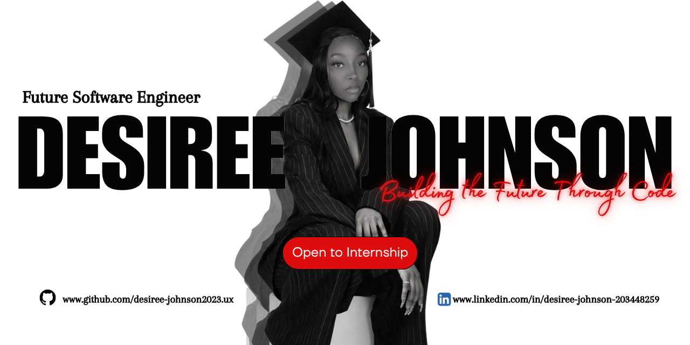

  

## ABOUT ME

I'm a Computer Science student with a passion for technology, software development, and creative problem-solving.

I enjoy breaking down complex problems, exploring how software works, and turning ideas into functional applications. My goal is to continue developing my programming skills and build meaningful technology solutions.

I'm currently working toward my Computer Science degree and expanding my experience through academic projects and independent learning.

---

## TECHNICAL SKILLS

**Programming Languages**
- Java
- C++

**Development Tools**
- GitHub
- Eclipse
- Git

**Areas of Interest**
- Software Engineering
- Application Development
- Software Testing
- Problem-Solving
- Technology and Innovation

---

## SELECTED PROJECTS

**Java Development**
- Working with object-oriented programming.
- Developing and testing Java applications using JUnit.

**C++ Development**
- Exploring data structures and algorithms.
- Working with sorting techniques and application development.

**Software Design and Analysis**
- Exploring software requirements, system design, and development processes.

More projects coming soon.

---

## MY DEVELOPMENT PROCESS

01 — UNDERSTAND  
Analyze requirements and identify the problem.

02 — PLAN  
Break complex tasks into manageable steps.

03 — DEVELOP  
Write clean, organized, and functional code.

04 — TEST  
Test frequently, identify errors, and make improvements.

05 — REFINE  
Review the results and make sure the solution meets expectations.

---

## EDUCATION & GROWTH

**Computer Science**

Southern New Hampshire University

Continuously learning, building, testing, and growing as a future software engineer.

---

### LET'S CONNECT

I'm always interested in learning, collaborating, and exploring new opportunities in technology.
[LinkedIn](https://www.linkedin.com/in/desiree-johnson-203448259)

**BUILDING THE FUTURE, ONE LINE OF CODE AT A TIME.**

